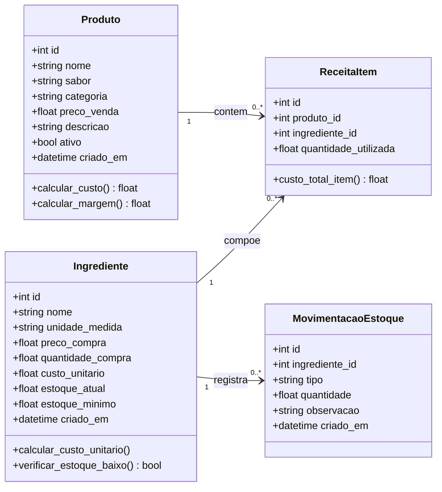
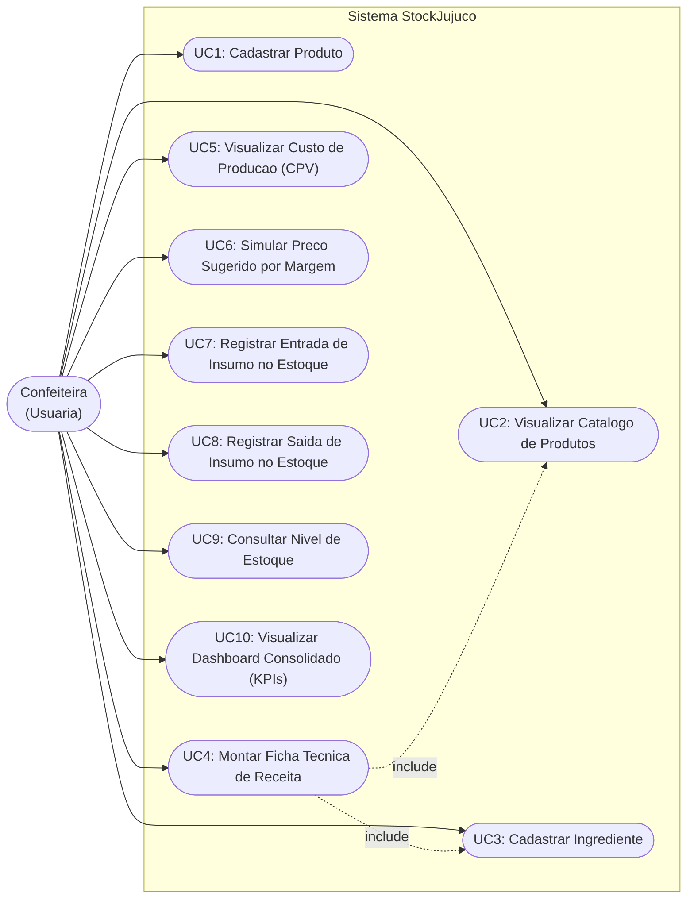

# StockJujuco

> Controle de produtos, ingredientes, ficha tecnica, custos, precificacao e estoque para confeitaria autonoma.

---

## Sobre o Projeto

O **StockJujuco** e um sistema web desenvolvido para auxiliar a **Juju Co.**, uma confeitaria artesanal operada por uma unica pessoa. O sistema organiza o catalogo de produtos vendidos, cadastra insumos e ingredientes, calcula automaticamente o custo de producao (CPV) de cada receita, apoia a tomada de decisao na precificacao e margens de lucro, e controla as entradas, saidas e niveis de estoque dos insumos com dashboard de indicadores chave (KPIs).

### Produtos cadastrados no catalogo
- Brownie - Chocolate Tradicional (Preco: R$ 12,00 | Custo CPV: R$ 4,37 | Margem: 63,6%)
- Brownie - Caramelo Salgado (Preco: R$ 14,00 | Custo CPV: R$ 6,14 | Margem: 56,1%)
- Brownie - Chocolate com Amendoim (Preco: R$ 13,00 | Custo CPV: R$ 4,94 | Margem: 62,0%)

---

## Modelagem e Diagramas do Sistema

Conforme os requisitos da Entrega Final (PROVA), apresentamos a seguir o **Diagrama de Classes** e o **Diagrama de Caso de Uso** que regem a arquitetura do sistema.

### 1. Diagrama de Classes (UML)

O diagrama abaixo ilustra as entidades do sistema, seus atributos, tipos, metodos e relacionamentos estruturais:



- Arquivo visual exportado: [docs/diagrama_classes.svg](docs/diagrama_classes.svg)

---

### 2. Diagrama de Caso de Uso (UML)

O diagrama abaixo descreve as interacoes entre o ator principal (**Confeiteira**) e os casos de uso providos pela aplicacao:



- Arquivo visual exportado: [docs/diagrama_caso_uso.svg](docs/diagrama_caso_uso.svg)

---

## Arquitetura

O projeto segue a arquitetura em tres camadas:

```
+-----------------+     HTTP/REST     +------------------+     SQLAlchemy     +----------+
|    FRONT-END    | <---------------> |     BACK-END     | <----------------> |  BANCO   |
|  React + Vite   |                   | Python + FastAPI |                    |  SQLite  |
|  localhost:5173 |                   |  127.0.0.1:8000  |                    |   .db    |
+-----------------+                   +------------------+                    +----------+
```

---

## Tecnologias

| Camada | Tecnologia | Versao |
|--------|-----------|--------|
| Front-end | React | 18.x |
| Front-end | Vite | 5.x |
| Front-end | React Router DOM | 6.x |
| Front-end | Axios | 1.x |
| Back-end | Python | 3.10+ |
| Back-end | FastAPI | 0.111+ |
| Back-end | SQLAlchemy | 2.x |
| Back-end | Pydantic | 2.x |
| Back-end | Uvicorn | 0.30+ |
| Banco de dados | SQLite | 3.x |

---

## Estrutura do Projeto

```
StockJujuco/
|-- backend/
|   |-- main.py              # Endpoints REST (produtos, ingredientes, receitas, custos, estoque, dashboard)
|   |-- database.py          # Conexao SQLite e seed completo de dados e estoque
|   |-- models.py            # Modelos SQLAlchemy (Produto, Ingrediente, ReceitaItem, MovimentacaoEstoque)
|   |-- schemas.py           # Schemas Pydantic com validacao e respostas
|   |-- requirements.txt     # Dependencias Python
|   `-- stockjujuco.db       # Banco de dados SQLite persistente
|-- frontend/
|   |-- index.html
|   |-- vite.config.js
|   |-- package.json
|   `-- src/
|       |-- main.jsx
|       |-- App.jsx
|       |-- index.css           # Identidade visual Juju Co. (tons de rosa e verde)
|       |-- components/
|       |   |-- Navbar.jsx
|       |   |-- ProdutoCard.jsx
|       |   `-- ProdutoForm.jsx
|       `-- pages/
|           |-- Home.jsx
|           |-- Produtos.jsx
|           |-- Ingredientes.jsx # Gestao de insumos e custos unitarios
|           |-- Precificacao.jsx # Ficha tecnica, CPV e simulador de precos
|           |-- Estoque.jsx      # Controle de entradas, saidas e alertas de reposicao
|           `-- Dashboard.jsx    # Indicadores consolidados do negocio
|-- docs/
|   |-- diagrama_classes.svg     # Diagrama de Classes UML
|   `-- diagrama_caso_uso.svg    # Diagrama de Caso de Uso UML
|-- demo/
|   `-- index.html           # Demonstracao autonoma completa (6 modulos em pagina unica)
|-- .gitignore
`-- README.md
```

---

## Como Executar

### Pre-requisitos
- Python 3.10 ou superior
- pip

### 1. Clonar o repositorio

```bash
git clone https://github.com/Gabstherin/StockJujuco.git
cd StockJujuco
```

### 2. Executar o Back-end (FastAPI)

```bash
cd backend

# Criar e ativar ambiente virtual (opcional)
python -m venv venv
venv\Scripts\activate      # Windows
# source venv/bin/activate # Linux/Mac

# Instalar dependencias
pip install -r requirements.txt

# Iniciar servidor FastAPI
python -m uvicorn main:app --host 0.0.0.0 --port 8000 --reload
```

- API disponivel em: **http://127.0.0.1:8000**
- Documentacao interativa (Swagger UI): **http://127.0.0.1:8000/docs**

### 3. Executar o Front-end

#### Opcao A: Demonstracao Autonoma (Nao requer Node.js)
Ideal para avaliacao imediata em qualquer ambiente:

```bash
# Na raiz do projeto:
python -m http.server 3000 --directory demo
```
- Acesse no navegador: **http://localhost:3000**

#### Opcao B: Front-end React + Vite
```bash
cd frontend
npm install
npm run dev
```
- Aplicacao disponivel em: **http://localhost:5173**

---

## Endpoints da API

### 1. Produtos (AC01)
| Metodo | Endpoint | Descricao |
|--------|----------|-----------|
| GET | `/` | Health check da API |
| GET | `/produtos` | Listar produtos com custos e margens calculados |
| POST | `/produtos` | Cadastrar novo produto no catalogo |

### 2. Ingredientes (AC02)
| Metodo | Endpoint | Descricao |
|--------|----------|-----------|
| GET | `/ingredientes` | Listar ingredientes com custo unitario e estoque |
| POST | `/ingredientes` | Cadastrar novo insumo com calculo de custo unitario |
| DELETE | `/ingredientes/{id}` | Excluir ingrediente |

### 3. Ficha Tecnica e Receitas (AC02)
| Metodo | Endpoint | Descricao |
|--------|----------|-----------|
| GET | `/produtos/{id}/receita` | Listar insumos e quantidades da receita |
| POST | `/produtos/{id}/receita` | Adicionar ou atualizar item na ficha tecnica |
| DELETE | `/receita-itens/{id}` | Remover item da receita |

### 4. Custos e Precificacao (AC03)
| Metodo | Endpoint | Descricao |
|--------|----------|-----------|
| GET | `/produtos/{id}/precificacao` | Detalhamento de CPV, margem real e precos sugeridos |
| GET | `/precificacao/resumo` | Resumo financeiro consolidado de todos os produtos |

### 5. Controle de Estoque (Entrega Final)
| Metodo | Endpoint | Descricao |
|--------|----------|-----------|
| GET | `/estoque` | Consultar niveis atuais e status de alerta (OK, BAIXO, CRITICO) |
| POST | `/estoque/entrada` | Registrar entrada de insumo e atualizar saldo |
| POST | `/estoque/saida` | Registrar saida de insumo (com validacao de saldo) |
| GET | `/estoque/movimentacoes` | Historico completo de movimentacoes |

### 6. Dashboard Executivo (Entrega Final)
| Metodo | Endpoint | Descricao |
|--------|----------|-----------|
| GET | `/dashboard` | Indicadores consolidados (produtos, CPV medio, margens, alertas de estoque) |

---

## Roadmap de Entregas

| Entrega | Data | Funcionalidade Principal | Status |
|---------|------|--------------------------|--------|
| AC01 | 14/09/2026 | Catalogo de produtos | Concluido |
| AC02 | 13/10/2026 | Ingredientes e receitas | Concluido |
| AC03 | 08/11/2026 | Custos e precificacao | Concluido |
| PROVA (Entrega Final) | 22/11/2026 | Estoque, dashboard, diagramas de classes e caso de uso | Concluido (Entrega Atual) |

---

## Tarefas da Sprint e Backlog (Issues)

Todas as atividades estao mapeadas no [Quadro de Projetos](https://github.com/users/Gabstherin/projects/1/views/1) e vinculadas as Issues do repositorio:

### AC01 - Concluidas
- [#1](https://github.com/Gabstherin/StockJujuco/issues/1) Criar repositorio GitHub do StockJujuco e documentacao inicial
- [#2](https://github.com/Gabstherin/StockJujuco/issues/2) Configurar banco SQLite e tabela produtos com seed inicial
- [#3](https://github.com/Gabstherin/StockJujuco/issues/3) Desenvolver API FastAPI com endpoints GET e POST /produtos
- [#4](https://github.com/Gabstherin/StockJujuco/issues/4) Desenvolver interface React + Vite com identidade visual Juju Co.
- [#5](https://github.com/Gabstherin/StockJujuco/issues/5) Implementar formulario de cadastro de novo produto
- [#6](https://github.com/Gabstherin/StockJujuco/issues/6) Integrar front-end com a API e garantir persistencia dos dados
- [#7](https://github.com/Gabstherin/StockJujuco/issues/7) Gravar video de demonstracao da funcionalidade da AC01
- [#8](https://github.com/Gabstherin/StockJujuco/issues/8) Realizar submissao da AC01 no Google Classroom

### AC02 / AC03 - Concluidas
- [#9](https://github.com/Gabstherin/StockJujuco/issues/9) Cadastrar ingredientes da confeitaria e calculo do custo unitario
- [#10](https://github.com/Gabstherin/StockJujuco/issues/10) Compor receitas associando ingredientes aos produtos (Ficha Tecnica)
- [#11](https://github.com/Gabstherin/StockJujuco/issues/11) Calcular custo automatico da receita por produto (CPV)
- [#12](https://github.com/Gabstherin/StockJujuco/issues/12) Definir margem de lucro e simulador interativo de precificacao sugerida
- [#15](https://github.com/Gabstherin/StockJujuco/issues/15) Realizar submissao da AC03 no Google Classroom

### PROVA / Entrega Final - Concluidas
- [#13](https://github.com/Gabstherin/StockJujuco/issues/13) Controle de estoque - entradas, saidas e alertas de insumos
- [#14](https://github.com/Gabstherin/StockJujuco/issues/14) Dashboard consolidado para a confeiteira com KPIs do negocio

### PROVA / Entrega Final - Em Andamento
- [#16](https://github.com/Gabstherin/StockJujuco/issues/16) Realizar submissao da Entrega Final (PROVA) no Google Classroom

---

## Integrantes

| Nome | RA |
|------|----|
| Gabriela Andrade | 2500734 |

---

## Links do Projeto

- Repositorio GitHub: https://github.com/Gabstherin/StockJujuco
- Quadro de Atividades (Board): https://github.com/users/Gabstherin/projects/1/views/1
- Diagrama de Classes UML: [docs/diagrama_classes.svg](docs/diagrama_classes.svg)
- Diagrama de Caso de Uso UML: [docs/diagrama_caso_uso.svg](docs/diagrama_caso_uso.svg)
- Video de Demonstracao AC01: Anexado no Google Classroom (Stockjujuco_test.mp4)
- Video de Demonstracao AC03: Anexado diretamente na entrega da atividade no Google Classroom
- Video de Demonstracao PROVA (Final): Anexado diretamente na entrega da atividade no Google Classroom

---

Desenvolvido para a disciplina de Projeto de Software - Faculdade Impacta Tecnologia, 2026.
